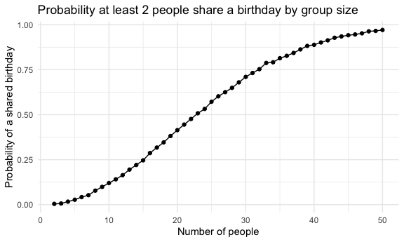

p8105_hw5_nel2139
================
Nicole Lewis
2026-11-10

``` r
library(tidyverse)
library(rvest)
library(p8105.datasets)

source("source/birthday_repeated.R")
set.seed(1236)
```

## Problem 1

I created a function that draws a birthday for each of `n_room` people,
assuming 365 equally likely days, checks for duplicates and returns
`TRUE` if at least two people share a birthday and `FALSE` if not. This
function was created in a separate R script and saved under
`source/birthday_repeated.R`.

Function

``` r
birthday_repeated
```

    ## function (n_room) 
    ## {
    ##     birthdays = sample(1:365, size = n_room, replace = TRUE)
    ##     repeated_birthdays = length(unique(birthdays)) < n_room
    ##     return(repeated_birthdays)
    ## }

Run the function 10000 times for each group size between 2 and 50

``` r
birthday_results_df = 
  expand_grid(
    n_people = 2:50,
    iter = 1:10000
  ) |> 
  mutate(
    repeated = map_lgl(n_people, birthday_repeated)
  )
```

Compute and plot probability of a shared birthday by group size

``` r
birthday_results_df |> 
  group_by(n_people) |> 
  summarize(prob_of_repeat = mean(repeated)) |> 
  ggplot(aes(x = n_people, y = prob_of_repeat)) + 
  geom_point() + 
  geom_line() +
  labs(
    title = "Probability at least 2 people share a birthday by group size", 
    x = "Number of people",
    y = "Probability of a shared birthday"
  )
```



The probability that at least two people share a birthday increases as
the group size increases. Interestingly, only about 23 people are needed
for there to be a 50% chance that two people share a birthday, and with
only 50 people, the chance increases to about 97%!
