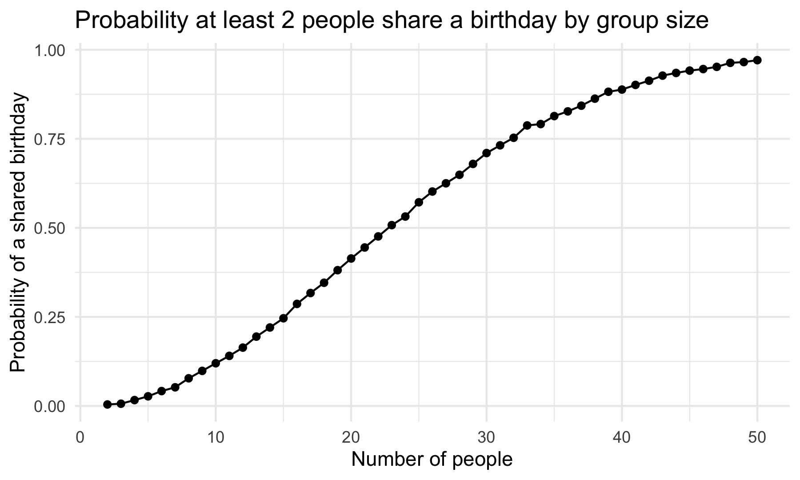
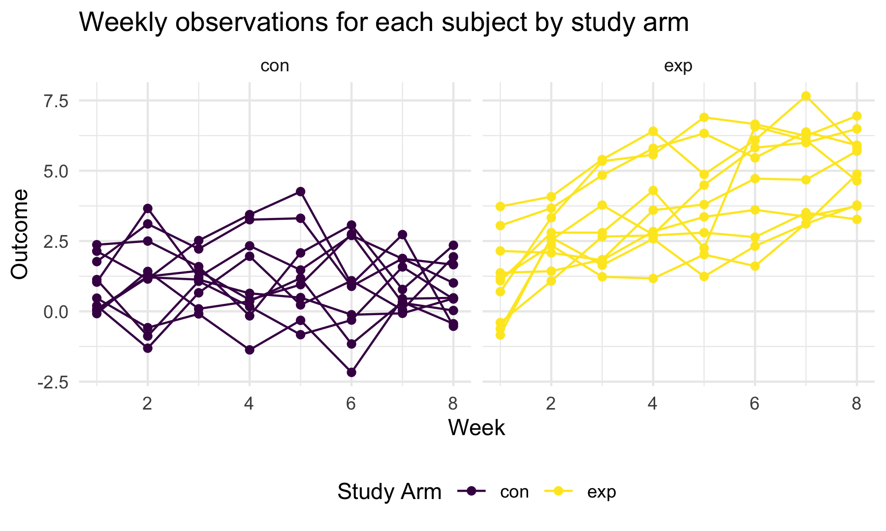

p8105_hw5_nel2139
================
Nicole Lewis
2026-11-10

``` r
library(tidyverse)
library(rvest)
library(p8105.datasets)

source("source/birthday_repeated.R")
source("source/sim_ttest.R")
set.seed(1236)
```

## Problem 1

I created a function that draws a birthday for each of `n_room` people,
assuming 365 equally likely days, checks for duplicates and returns
`TRUE` if at least two people share a birthday and `FALSE` if not. This
function was created in a separate R script and saved under
`source/birthday_repeated.R`.

Function

``` r
birthday_repeated
```

    ## function (n_room) 
    ## {
    ##     birthdays = sample(1:365, size = n_room, replace = TRUE)
    ##     repeated_birthdays = length(unique(birthdays)) < n_room
    ##     return(repeated_birthdays)
    ## }

Run the function 10000 times for each group size between 2 and 50

``` r
birthday_results_df = 
  expand_grid(
    n_people = 2:50,
    iter = 1:10000
  ) |> 
  mutate(
    repeated = map_lgl(n_people, birthday_repeated)
  )
```

Compute and plot probability of a shared birthday by group size

``` r
birthday_results_df |> 
  group_by(n_people) |> 
  summarize(prob_of_repeat = mean(repeated)) |> 
  ggplot(aes(x = n_people, y = prob_of_repeat)) + 
  geom_point() + 
  geom_line() +
  labs(
    title = "Probability at least 2 people share a birthday by group size", 
    x = "Number of people",
    y = "Probability of a shared birthday"
  )
```



The probability that at least two people share a birthday increases as
the group size increases. Interestingly, only about 23 people are needed
for there to be a 50% chance that two people share a birthday, and with
only 50 people, the chance increases to about 97%!

## Problem 2

Importing the data

``` r
full_df = 
  tibble(
    files = list.files("data/"),
    path = str_c("data/", files)
  ) |> 
  mutate(data = map(path, read_csv)) |> 
  unnest(data)
```

Tidying data

``` r
tidy_df = 
  full_df |> 
  mutate(
    files = str_replace(files, ".csv", ""),
    group = str_sub(files, 1, 3),
    subject_id = str_sub(files, 5, 6)) |> 
  pivot_longer(
    week_1:week_8,
    names_to = "week",
    values_to = "outcome",
    names_prefix = "week_") |> 
  mutate(week = as.numeric(week)) |> 
  select(group, subject_id, week, outcome)
```

Spaghetti plot

``` r
tidy_df |> 
  ggplot(aes(x = week, y = outcome, group = subject_id, color = group)) +
  geom_point() +
  geom_path() +
  facet_grid(~group) +
  labs(
    title = "Weekly observations for each subject by study arm",
    x = "Week",
    y = "Outcome",
    color = "Study Arm"
  )
```



At week 1, the two arms start at similar values, with outcomes roughly
between -1 and 4, though the values are more spread out in the
experimental group. Over the 8 weeks, subjects in the control arm show
no clear trend, their outcomes fluctuate between about -2 and 4 and end
near where they started. In contrast, subjects in the experimental arm
show a steady increase over time, ending between about 3 and 7 by week
8. At the end, experimental subjects have higher outcome values than
control subjects, suggesting the experimental condition is associated
with increasing outcomes over time.

## Problem 3

A function was created to generate a random sample of size 30 from a
normal distribution with mean mu and standard deviation 5, run a
one-sample t-test of H0: mu=0, and return the estimated mu and p-value.
The function was made in a separate R script and saved under
`source/sim_ttest.R`.

Function

``` r
sim_ttest
```

    ## function (n_obs = 30, mu, sigma = 5) 
    ## {
    ##     sim_df = tibble(x = rnorm(n = n_obs, mean = mu, sd = sigma))
    ##     ttest = t.test(x ~ 1, data = sim_df, mu = 0)
    ##     return_df = select(broom::tidy(ttest), mu_hat = estimate, 
    ##         p_value = p.value)
    ##     return(return_df)
    ## }

The function was run 5000 times for each true mu = 0, 1, 2, 3, 4, 5, 6.
The null hypothesis was rejected when the p-value was less than or equal
to 0.05.

``` r
sim_results_df = 
  expand_grid(
    true_mu = 0:6,
    iter = 1:5000
  ) |> 
  mutate(
    estimate_df = map(true_mu, \(x) sim_ttest(mu = x))
  ) |> 
  unnest(estimate_df) |> 
  mutate(reject = p_value <= 0.05)
```
